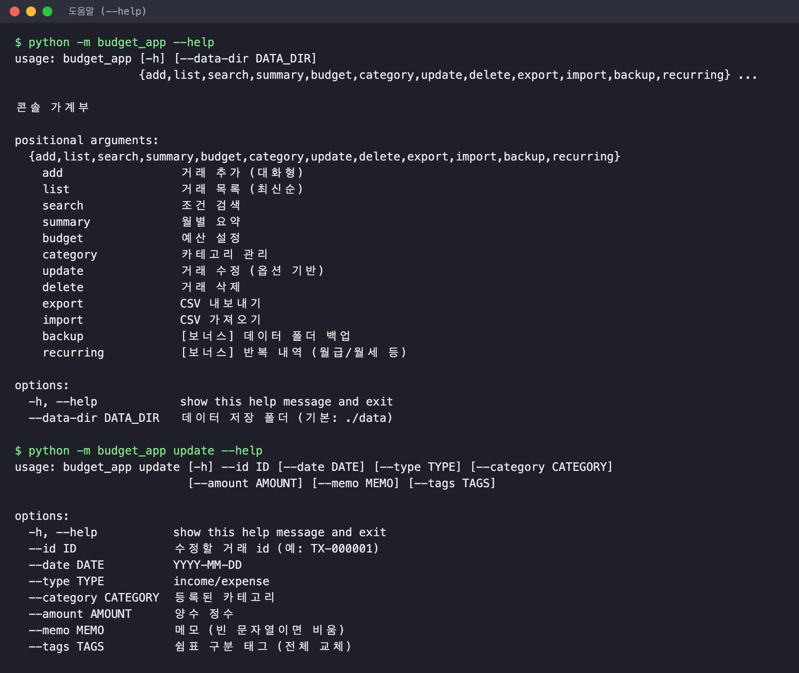
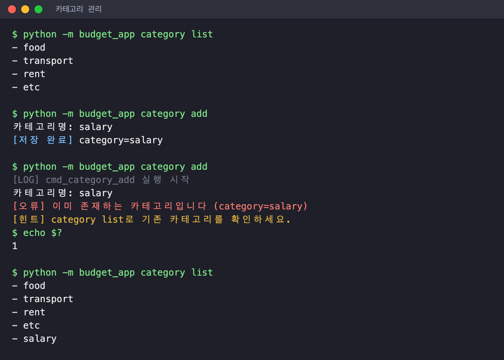
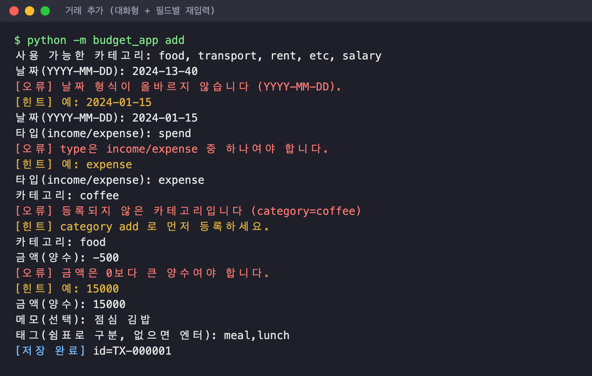
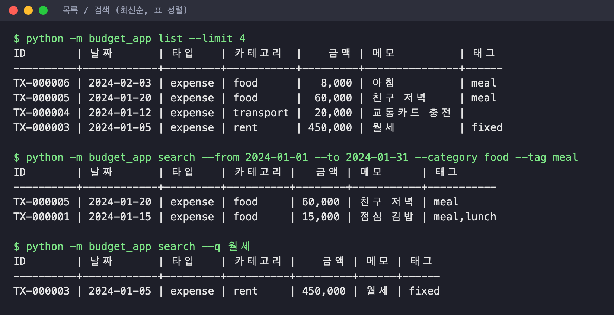
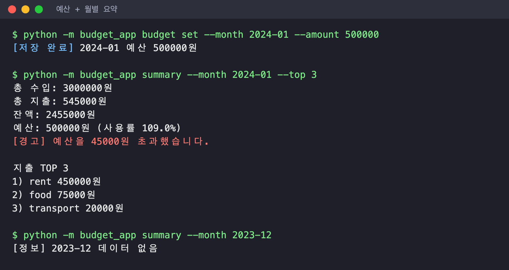
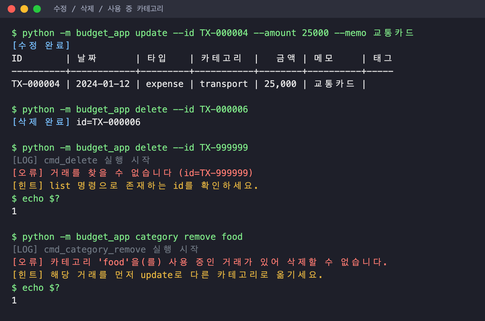
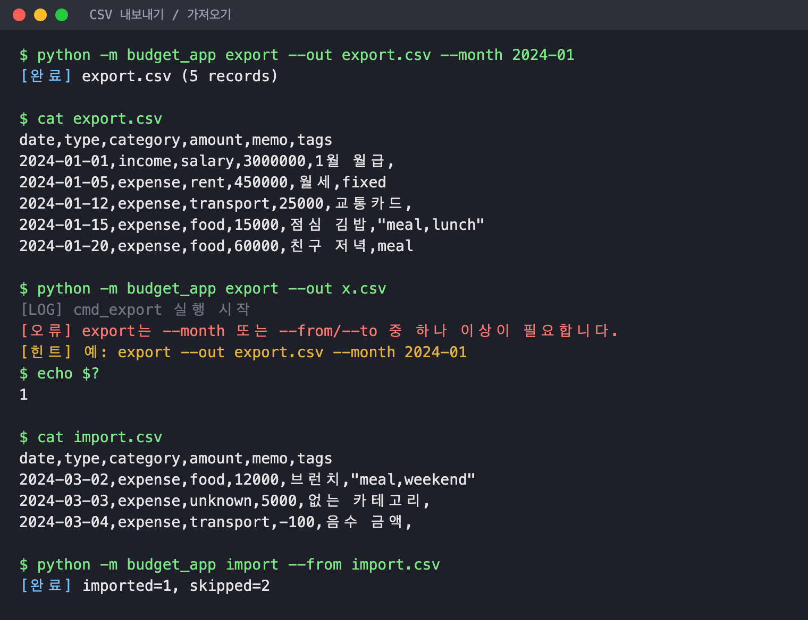
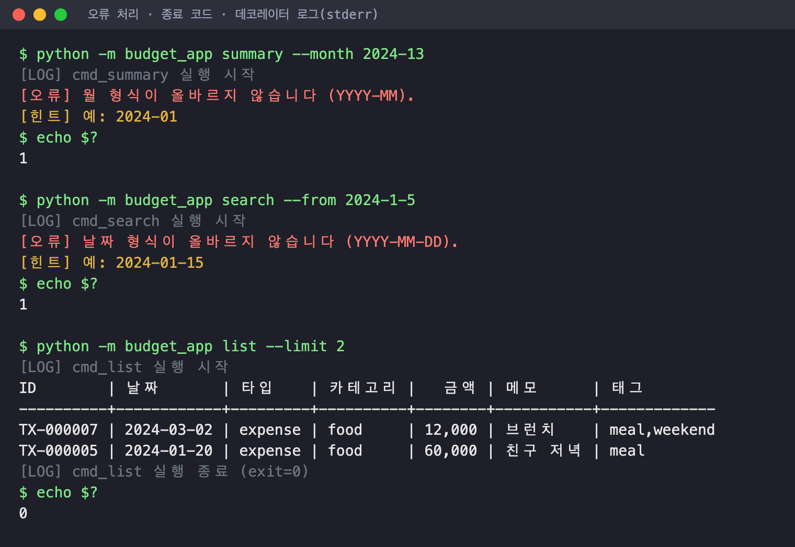
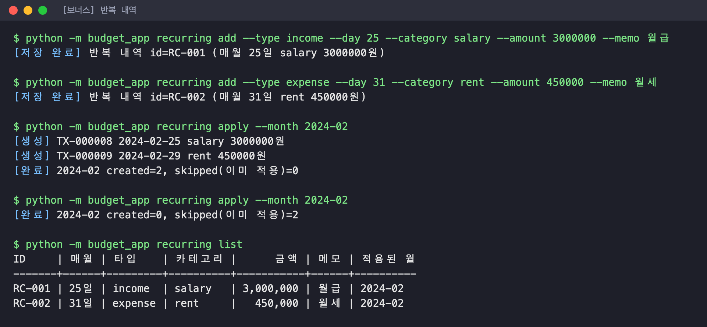
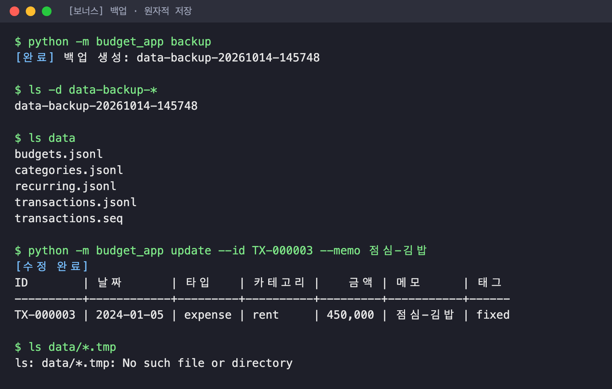

# codyssey-budget-app — 나만의 용돈 기입장

Codyssey **B2-1. 나만의 용돈 기입장 프로그램 만들기** 미션 결과물입니다.
Python **표준 라이브러리만** 사용하는 콘솔 가계부로, 데이터는 JSONL 파일에 영구 저장됩니다.

- 필수 기능 10종 + **보너스 4종(백업 · 반복 내역 · 표 정렬 · 저장 원자성)** 모두 구현
- 제너레이터 스트리밍 · 데코레이터 · 타입 힌트 · 계층별 모듈 분리
- 설계와 구현 상세: **[기술 설명서 (docs/TECHNICAL.md)](docs/TECHNICAL.md)**

---

## 목차

1. [빠른 시작](#1-빠른-시작)
2. [미션 요구사항 체크리스트](#2-미션-요구사항-체크리스트)
3. [명령어 사용법 (스크린샷)](#3-명령어-사용법-스크린샷)
4. [저장 파일 위치와 형식](#4-저장-파일-위치와-형식)
5. [import/export CSV 스키마](#5-importexport-csv-스키마)
6. [오류 처리](#6-오류-처리)
7. [프로젝트 구조](#7-프로젝트-구조)
8. [테스트](#8-테스트)

---

## 1. 빠른 시작

**요구 사항**: Python 3.10 이상. 설치할 외부 패키지는 없습니다.

```bash
git clone <this-repo> && cd codyssey-budget-app
python3 -m budget_app --help
```

처음 실행하면 `./data` 폴더와 기본 카테고리(`food`, `transport`, `rent`, `etc`)가 자동 생성됩니다.
5분 체험 시나리오:

```bash
python3 -m budget_app add                       # 대화형으로 거래 1건 입력
python3 -m budget_app list --limit 5            # 최근 5건
python3 -m budget_app budget set --month 2024-01 --amount 500000
python3 -m budget_app summary --month 2024-01   # 수입/지출/잔액 + 예산 사용률
```

모든 명령은 `--data-dir <폴더>`로 저장 위치를 바꿀 수 있습니다 (예: `python3 -m budget_app --data-dir ./demo list`).

---

## 2. 미션 요구사항 체크리스트

### 필수 기능

| # | 기능 | 명령 | 상태 |
| --- | --- | --- | --- |
| 1 | 거래 추가 (대화형, 생성 id 출력) | `add` | ✅ |
| 2 | 거래 목록 (최신순, `--limit`, 스트리밍) | `list` | ✅ |
| 3 | 거래 검색 (`--from/--to/--category/--type/--q/--tag`) | `search` | ✅ |
| 4 | 월별 요약 (총수입/총지출/잔액 + 지출 TOP N) | `summary` | ✅ |
| 5 | 예산 설정 + 사용률/초과 경고 | `budget set`, `summary` | ✅ |
| 6 | 카테고리 관리 (사용 중이면 삭제 거부) | `category add/list/remove` | ✅ |
| 7 | 거래 수정 (없는 id 처리) | `update` | ✅ |
| 8 | 거래 삭제 (없는 id 처리) | `delete` | ✅ |
| 9 | CSV 가져오기 | `import` | ✅ |
| 10 | CSV 내보내기 (`--month` 또는 `--from/--to` 필수) | `export` | ✅ |

### 구현/제약 조건

| 항목 | 구현 |
| --- | --- |
| 실행 방식 | `python -m budget_app <command> [options]`, 모든 명령 `--help` 지원 |
| 옵션 표기 | `--` 로 통일 |
| 데이터 모델 | `Transaction` dataclass (id, type, date, amount, category, memo, tags), 클래스 10개 이상 |
| 저장 | JSONL, `transactions` / `categories` / `budgets` **3개 이상 파일**로 분리, 기본 `./data` |
| 초기 실행 | 폴더/파일 자동 생성, 카테고리 비었으면 기본 카테고리 자동 생성 **(안 A)** |
| update 방식 | **옵션 기반(안 A)으로 고정**: `update --id <id> [--date] [--type] [--category] [--amount] [--memo] [--tags]` |
| 스트리밍 | `list`/`search`는 파일을 뒤에서부터 8KB씩 읽는 제너레이터로 최신순 처리 |
| 데코레이터 | `handle_errors` · `log_execution` · `measure_time` 3종 구현·적용 |
| 타입 힌트 | 모든 공개 함수/메서드 |
| 모듈화 | 8개 모듈 (모델 / 저장소 / 서비스 / CLI / CSV / 포맷터 / 데코레이터 / 예외) |
| 오류 | 스택트레이스 없이 `[오류] 원인` + `[힌트] 해결`, 정상 0 / 오류 1 |
| 라이브러리 | 표준 라이브러리만 |

### 보너스 과제

| 보너스 | 명령/위치 | 상태 |
| --- | --- | --- |
| 백업 (타임스탬프 포함) | `backup` | ✅ |
| 반복 내역 (월급/월세 자동 생성) | `recurring add/list/remove/apply` | ✅ |
| 출력 포맷 테이블 정렬 (한글 폭 고려) | `formatters.py` | ✅ |
| 저장 원자성 강화 (임시 파일 + rename) | `storage.rewrite_all` | ✅ |

---

## 3. 명령어 사용법 (스크린샷)

> 아래 스크린샷은 모두 실제 명령 실행 결과입니다. `[LOG]`/`[TIME]`(데코레이터 출력)은
> stderr로 나가며, 오류 예시 화면에서만 함께 표시했습니다.

### 3.1 도움말 — `--help`

모든 명령과 하위 명령에서 `--help`로 사용법을 볼 수 있습니다.



### 3.2 카테고리 관리 — `category add / list / remove`

```bash
python3 -m budget_app category list
python3 -m budget_app category add            # 대화형 (카테고리명 입력)
python3 -m budget_app category add salary     # 인자로 바로 지정도 가능
python3 -m budget_app category remove rent    # 사용 중이면 삭제 거부
```



### 3.3 거래 추가 — `add` (대화형)

각 항목을 입력하는 즉시 검증하고, **틀린 항목만 다시** 묻습니다.
(잘못된 날짜 → 잘못된 타입 → 없는 카테고리 → 음수 금액을 차례로 넣어 본 화면)



### 3.4 목록 / 검색 — `list`, `search`

```bash
python3 -m budget_app list --limit 4
python3 -m budget_app search --from 2024-01-01 --to 2024-01-31 --category food --tag meal
python3 -m budget_app search --q 월세          # 메모 키워드
python3 -m budget_app search --type income
```

결과는 최신순(최근 등록순)이며 한글이 섞여도 열이 맞도록 표로 정렬됩니다.



### 3.5 예산 + 월별 요약 — `budget set`, `summary`

```bash
python3 -m budget_app budget set --month 2024-01 --amount 500000
python3 -m budget_app summary --month 2024-01 --top 3
```

예산이 있으면 사용률을, 초과하면 초과 금액과 함께 경고를 출력합니다. 데이터가 없는 달은 "데이터 없음".



### 3.6 수정 / 삭제 — `update`, `delete`

`update`는 **옵션 방식으로 고정**되어 있으며, 지정한 필드만 바뀝니다.

```bash
python3 -m budget_app update --id TX-000004 --amount 25000 --memo 교통카드
python3 -m budget_app delete --id TX-000006
```

없는 id, 사용 중인 카테고리 삭제 시도는 원인과 힌트를 출력하고 exit code 1로 끝납니다.



### 3.7 CSV 내보내기 / 가져오기 — `export`, `import`

```bash
python3 -m budget_app export --out export.csv --month 2024-01
python3 -m budget_app export --out q1.csv --from 2024-01-01 --to 2024-03-31
python3 -m budget_app import --from import.csv
```

`export`는 조건(`--month` 또는 `--from/--to`)이 없으면 거부합니다. `import`는 잘못된 행
(없는 카테고리, 음수 금액, 잘못된 날짜 등)을 건너뛰고 처리 건수를 알려 줍니다.



### 3.8 오류 처리 · 종료 코드 · 데코레이터 로그

스택트레이스 대신 `[오류]` + `[힌트]`를 출력하고, 실패 시 exit code가 0이 아닙니다.
회색 `[LOG]` 줄은 `log_execution` 데코레이터의 출력(stderr)입니다.



### 3.9 [보너스] 반복 내역 — `recurring`

```bash
python3 -m budget_app recurring add --type income  --day 25 --category salary --amount 3000000 --memo 월급
python3 -m budget_app recurring add --type expense --day 31 --category rent   --amount 450000  --memo 월세
python3 -m budget_app recurring apply --month 2024-02   # 해당 월 거래 자동 생성
python3 -m budget_app recurring list
python3 -m budget_app recurring remove --id RC-001
```

- 같은 달에 `apply`를 두 번 실행해도 중복 생성되지 않습니다.
- `--day 31`은 2월에 말일(2024-02-29)로 보정됩니다.



### 3.10 [보너스] 백업 · 원자적 저장 — `backup`

```bash
python3 -m budget_app backup     # ./data-backup-YYYYMMDD-HHMMSS/ 생성
```

`update`/`delete`는 임시 파일(`*.tmp`)에 쓴 뒤 `os.replace`로 교체하므로, 작업 후 임시 파일이 남지 않고
중간에 실패해도 원본이 손상되지 않습니다.



---

## 4. 저장 파일 위치와 형식

기본 폴더 `./data` (`--data-dir`로 변경). 형식은 **JSONL** — 한 줄에 JSON 객체 하나, UTF-8.

| 파일 | 내용 | 예시 한 줄 |
| --- | --- | --- |
| `transactions.jsonl` | 거래 내역 | `{"id": "TX-000001", "type": "expense", "date": "2024-01-15", "amount": 15000, "category": "food", "memo": "점심", "tags": ["meal"]}` |
| `categories.jsonl` | 카테고리 | `{"name": "food"}` |
| `budgets.jsonl` | 월별 예산 | `{"month": "2024-01", "amount": 500000}` |
| `recurring.jsonl` | [보너스] 반복 내역 규칙 | `{"id": "RC-001", "type": "income", "day": 25, "amount": 3000000, "category": "salary", "memo": "월급", "tags": [], "applied_months": ["2024-02"]}` |
| `transactions.seq` | 마지막 발급 id 번호 (삭제된 id 재사용 방지) | `7` |

---

## 5. import/export CSV 스키마

UTF-8, **헤더 포함**, 컬럼명 고정:

| column | required | 설명 |
| --- | --- | --- |
| date | Y | `YYYY-MM-DD` |
| type | Y | `income` / `expense` |
| category | Y | 등록된 카테고리 |
| amount | Y | 양수 정수 |
| memo | N | 문자열 |
| tags | N | 쉼표(`,`) 구분 문자열 (CSV 규칙에 따라 따옴표로 감쌈) |

```csv
date,type,category,amount,memo,tags
2024-01-15,expense,food,15000,점심 김밥,"meal,lunch"
2024-01-01,income,salary,3000000,1월 월급,
```

- `export`는 날짜 오름차순으로 저장합니다.
- `import`는 각 행을 `add`와 같은 규칙으로 검증하며, 실패한 행은 `skipped`로 집계합니다.
  필수 컬럼이 헤더에 없으면 전체를 거부합니다.

---

## 6. 오류 처리

| 상황 | 출력 예 | exit |
| --- | --- | --- |
| 잘못된 날짜 | `[오류] 날짜 형식이 올바르지 않습니다 (YYYY-MM-DD).` / `[힌트] 예: 2024-01-15` | 1 |
| 없는 id | `[오류] 거래를 찾을 수 없습니다 (id=TX-999999)` / `[힌트] list 명령으로 존재하는 id를 확인하세요.` | 1 |
| 사용 중 카테고리 삭제 | `[오류] 카테고리 'food'을(를) 사용 중인 거래가 있어 삭제할 수 없습니다.` | 1 |
| export 조건 누락 | `[오류] export는 --month 또는 --from/--to 중 하나 이상이 필요합니다.` | 1 |
| 정상 | — | 0 |

대화형 입력(`add`)에서는 오류가 나도 종료하지 않고 해당 항목만 다시 묻습니다.

---

## 7. 프로젝트 구조

```
codyssey-budget-app/
├── budget_app/
│   ├── __main__.py     # python -m budget_app 진입점
│   ├── cli.py          # [CLI]    argparse 명령 정의, 대화형 입력, 출력
│   ├── services.py     # [서비스] 입력 검증, 검색/요약/예산/반복 내역 규칙
│   ├── storage.py      # [저장소] JSONL I/O, 스트리밍 제너레이터, 원자적 교체
│   ├── models.py       # [모델]   Transaction, RecurringRule dataclass
│   ├── csv_io.py       # CSV import/export
│   ├── formatters.py   # [보너스] 한글 폭을 고려한 표 정렬
│   ├── decorators.py   # handle_errors / log_execution / measure_time
│   └── exceptions.py   # AppError / ValidationError / NotFoundError / ConflictError
├── tests/
│   └── test_budget_app.py   # unittest 종단 간 테스트 18개
└── docs/
    ├── TECHNICAL.md    # 기술 설명서
    ├── WORK_REPORT.md  # 작업 설명문
    └── screenshots/    # README 스크린샷
```

계층 간 책임, 스트리밍 알고리즘, 데코레이터 순서, 원자성 보장 방식은 [기술 설명서](docs/TECHNICAL.md)에 정리했습니다.

---

## 8. 테스트

표준 라이브러리 `unittest`만 사용합니다.

```bash
python3 -m unittest -v
```

필수 기능, 입력 검증/오류 처리, 보너스 기능, 과거 버그 회귀(0 패딩 없는 날짜 허용, 삭제된 id 재발급 등)를
실제 CLI 진입점을 통해 검증합니다. Python 3.10 / 3.14에서 통과를 확인했습니다.
