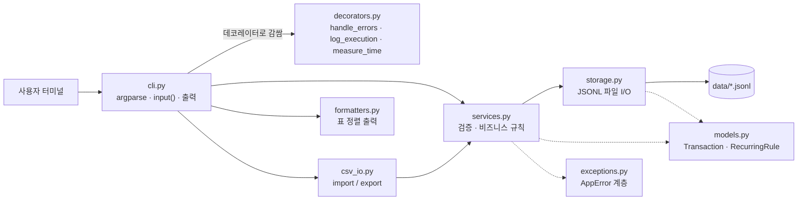

# 기술 설명서 — codyssey-budget-app (B2-1. 나만의 용돈 기입장)

이 문서는 코드가 **어떻게** 동작하고 **왜** 그렇게 설계했는지를 설명합니다.
실행 방법과 명령 예시는 [README](../README.md)를 참고하세요.

---

## 1. 전체 구조



| 계층 | 모듈 | 책임 | 하지 않는 일 |
| --- | --- | --- | --- |
| 모델 | `models.py` | `Transaction`, `RecurringRule` dataclass 정의, dict ↔ 객체 변환 | 검증, 파일 I/O |
| 저장소 | `storage.py` | JSONL 읽기/쓰기, 스트리밍 제너레이터, 원자적 교체, ID 발급 | 입력 검증 |
| 서비스 | `services.py` | 날짜/타입/금액/카테고리 검증, 검색 필터, 월별 요약, 반복 내역 | `print`, `input` |
| CLI | `cli.py` | 명령 파싱, 대화형 입력, 결과 출력 | 비즈니스 규칙 |
| 공통 관심사 | `decorators.py` | 오류 → 메시지/종료 코드, 실행 로그, 실행 시간 | — |
| 보조 | `csv_io.py`, `formatters.py`, `exceptions.py` | CSV 스키마, 표 출력, 도메인 예외 | — |

**의존 방향은 한쪽(CLI → 서비스 → 저장소 → 모델)으로만 흐릅니다.** 검증 규칙은
`services.py` 한 곳에만 있으므로, `add`(대화형)·`update`(옵션)·`import`(CSV)·
`recurring apply` 네 가지 입력 경로가 모두 같은 규칙을 거칩니다.

### 클래스 목록

| 클래스 | 위치 | 역할 |
| --- | --- | --- |
| `Transaction` | models | 거래 1건 (id, type, date, amount, category, memo, tags) |
| `RecurringRule` | models | [보너스] 반복 내역 규칙 (매월 day일, 적용된 월 목록) |
| `TransactionRepository` | storage | `transactions.jsonl` + `transactions.seq` |
| `CategoryStore` / `BudgetStore` / `RecurringStore` | storage | 각각 `categories` / `budgets` / `recurring` `.jsonl` |
| `TransactionService` / `CategoryService` / `BudgetService` / `RecurringService` | services | 검증 + 규칙 |
| `SearchFilter` / `MonthSummary` | services | 검색 조건 / 요약 결과 (dataclass) |
| `AppError` → `ValidationError` / `NotFoundError` / `ConflictError` | exceptions | 메시지 + 힌트를 가진 예외 |

---

## 2. 저장 방식

### 2.1 JSONL을 선택한 이유

- **한 줄 = 한 레코드**이므로 `add`는 파일 끝에 한 줄을 append하면 끝납니다(전체 재작성 불필요).
- 줄 단위로 읽으면 되므로 **제너레이터 스트리밍**과 궁합이 좋습니다.
- `tags`(리스트) 같은 구조를 CSV처럼 별도 인코딩할 필요가 없습니다.
- `ensure_ascii=False`로 저장해 한글 메모가 그대로 읽힙니다.

### 2.2 파일 구성 (`--data-dir`, 기본 `./data`)

| 파일 | 한 줄 예시 | 생성 시점 |
| --- | --- | --- |
| `transactions.jsonl` | `{"id": "TX-000001", "type": "expense", "date": "2024-01-15", "amount": 15000, "category": "food", "memo": "점심", "tags": ["meal"]}` | 첫 `add` |
| `categories.jsonl` | `{"name": "food"}` | 첫 실행 시 기본값 자동 생성 (food/transport/rent/etc) |
| `budgets.jsonl` | `{"month": "2024-01", "amount": 500000}` | 첫 `budget set` |
| `recurring.jsonl` | `{"id": "RC-001", "type": "income", "day": 25, "amount": 3000000, "category": "salary", "memo": "월급", "tags": [], "applied_months": ["2024-02"]}` | 첫 `recurring add` |
| `transactions.seq` | `7` (마지막으로 발급한 번호) | 첫 `add` |

카테고리 파일이 없을 때는 **(안 A) 기본 카테고리 자동 생성**을 택했습니다. 처음 쓰는
사람이 `add`부터 바로 시도해도 막히지 않게 하기 위함입니다.

### 2.3 ID 발급 정책

`TX-` + 6자리 번호. 다음 번호는 `max(transactions.seq, 파일 마지막 줄의 id) + 1`입니다.

- 파일 **마지막 줄만** 역방향으로 읽으므로 거래가 많아도 O(1)입니다.
- `.seq` 파일을 따로 두는 이유: 가장 최근 거래를 삭제한 뒤 새로 추가하면, 마지막 줄만 보는
  방식으로는 **삭제된 id가 재발급**됩니다(초기 구현의 버그, 테스트 `test_deleted_id_is_never_reused`).
  내보낸 CSV나 메모에 남은 옛 id가 다른 거래를 가리키게 되는 문제를 막습니다.

---

## 3. 제너레이터 스트리밍

### 3.1 정방향: `iter_forward(path)`

```python
with path.open("r", encoding="utf-8") as f:
    for line in f:          # 파일 객체 자체가 줄 단위 이터레이터
        if line.strip():
            yield json.loads(line)
```

`summary`, `category_in_use`, `update`, `delete`가 사용합니다. 한 번에 한 줄만 메모리에 있습니다.

### 3.2 역방향(최신순): `iter_reverse(path, buf_size=8192)`

`list`/`search`는 "최신순"이 요구사항입니다. 파일을 전부 읽고 뒤집으면 스트리밍이 아니므로,
**파일 끝에서부터 8KB씩 거꾸로 읽어** 줄을 잘라 냅니다.

```
파일:  [ ... 줄1 \n 줄2 \n 줄3 \n ]
                       ◀── 8KB 청크 ──┤ (끝에서 시작)
1) 청크를 "\n"으로 split
2) 맨 앞 조각(segment)은 줄 중간일 수 있으므로 보관 → 다음(더 앞쪽) 청크와 이어 붙임
3) 나머지 완성된 줄을 뒤에서부터 yield
4) 파일 맨 앞에 도달하면 보관한 segment를 마지막으로 yield
```

- 메모리 사용량은 `buf_size` + 가장 긴 한 줄 정도로 **파일 크기와 무관**합니다.
- 바이트 단위로 자른 뒤 **완성된 줄만 디코딩**하므로, 청크 경계가 한글(UTF-8 멀티바이트)
  중간에 걸려도 깨지지 않습니다.
- `list --limit N`은 N개를 yield한 뒤 `break`하므로, 최근 N건만 보려면 파일 끝 몇 KB만 읽습니다.

**"최신순"의 기준**: 등록(추가) 순서의 역순입니다. 날짜 기준 정렬은 전체를 읽어야만
가능하므로 스트리밍 요구와 충돌합니다. 일반적인 사용(그날그날 기록)에서는 두 순서가 같습니다.
`export`는 어차피 결과를 파일로 쓰므로 **날짜순(오름차순) 정렬**해 저장합니다.

### 3.3 출력도 스트리밍 유지

표 정렬을 하려면 열 너비를 알아야 해서 행을 모아야 합니다. `cli.print_pages()`는
`itertools.islice`로 **50행씩만** 모아 표 하나를 출력하므로, 검색 결과가 아무리 많아도
메모리에는 최대 50행만 머뭅니다.

---

## 4. 데코레이터 (공통 관심사 분리)

```python
@handle_errors      # 가장 바깥: 어떤 예외든 메시지 + 종료 코드로 변환
@log_execution      # [LOG] cmd_xxx 실행 시작 / 종료 (exit=0)
@measure_time       # [TIME] cmd_xxx 0.003s
def cmd_add(args) -> int: ...
```

| 데코레이터 | 하는 일 | 출력 |
| --- | --- | --- |
| `handle_errors` | `AppError` → `[오류] 원인` + `[힌트] 해결 방법`, `return 1`. `EOFError`(입력 끝), `KeyboardInterrupt`(Ctrl+C), 그 외 예외도 스택트레이스 없이 처리 | stderr |
| `log_execution` | 명령 이름과 종료 코드 기록 | stderr |
| `measure_time` | `time.perf_counter()`로 실행 시간 측정 | stderr |

- **순서가 중요한 이유**: `handle_errors`가 가장 바깥에 있어야 안쪽 데코레이터나 명령에서 난
  예외까지 모두 잡힙니다. 예외 발생 시 `log_execution`의 "종료" 로그는 찍히지 않고 바로
  오류 메시지가 나옵니다(스크린샷 08 참고).
- **stderr로 보내는 이유**: 로그가 stdout에 섞이면 `list > out.txt` 같은 리다이렉션 결과가
  오염됩니다. 정상 결과는 stdout, 진단 정보는 stderr로 분리했습니다.
- `functools.wraps`로 원래 함수 이름(`cmd_add`)을 보존해 로그에 정확한 이름이 찍힙니다.
- 타입 힌트 `F = TypeVar("F", bound=Callable[..., int])`로 "데코레이터를 거쳐도 시그니처가
  같다"는 계약을 표현했습니다.

명령 함수 본문에는 `try/except`도, 로그 코드도 없습니다. 새 명령을 추가할 때 데코레이터만
붙이면 같은 오류 처리 규칙이 자동으로 적용됩니다.

---

## 5. 타입 힌트

모든 공개 함수/메서드에 타입 힌트를 달았습니다(`from __future__ import annotations`로
Python 3.10에서도 `X | None` 문법 사용). 효과가 드러나는 예:

```python
def iter_reverse(path: Path, buf_size: int = 8192) -> Iterator[str]: ...
def list_latest(self, limit: int = 10) -> Iterator[Transaction]: ...
def import_csv(service: TransactionService, in_path: Path) -> tuple[int, int]: ...
def prompt(label: str, validator: Callable[[str], T] | None = None, default: str | None = None) -> T | str: ...
```

- `Iterator[...]` 반환 타입은 "이 함수는 리스트가 아니라 **한 번만 순회 가능한 스트림**을
  돌려준다"는 사실을 호출자에게 알려 줍니다(두 번 순회하면 비어 있음).
- `tuple[int, int]`는 import 결과가 `(imported, skipped)` 쌍임을 문서 없이도 알 수 있게 합니다.
- `BudgetStore.get(...) -> int | None`은 "예산이 없을 수 있다"를 강제로 의식하게 해서,
  `summary`에서 `None` 체크를 빠뜨리는 실수를 막습니다.
- `Transaction.amount: int`(양수), `type: str  # "income" | "expense"` 등 데이터 계약이
  dataclass 필드에 그대로 드러납니다.

---

## 6. 입력 검증

| 항목 | 규칙 | 위치 |
| --- | --- | --- |
| 날짜 | `YYYY-MM-DD`, 실제 존재하는 날짜, **0 패딩 필수** | `validate_date` |
| 월 | `YYYY-MM`, 0 패딩 필수 | `validate_month` |
| 타입 | `income` / `expense` | `validate_type` |
| 금액 | 정수, `> 0` | `validate_amount` |
| 카테고리 | 등록된 카테고리만 | `CategoryService.require_exists` |
| `--limit`, `--top` | `>= 1` | `validate_positive_int` |
| `--from` ≤ `--to` | 순서 확인 | `SearchFilter.__post_init__` |

**0 패딩을 강제하는 이유**: `strptime`은 `2024-1-5`도 통과시킵니다. 날짜를 문자열로 비교
(`txn.date < date_from`)하는 구조에서 `"2024-1-5" > "2024-01-10"`이 되어 기간 검색이
틀어집니다. 파싱 후 `strftime` 결과가 원문과 같은지 다시 비교해 막았습니다.

**대화형 재입력**: `add`는 필드마다 검증 함수를 `prompt()`에 넘겨, **틀린 필드만** 다시
묻습니다(전체 폼을 처음부터 다시 입력하지 않음).

**검색 조건 검증**: `SearchFilter`가 생성되는 순간 날짜·타입을 검증합니다. 오타
(`--type expnse`)가 "검색 결과 없음"으로 조용히 넘어가지 않고 오류로 알려 줍니다.

---

## 7. 수정/삭제와 원자성 (보너스: 저장 원자성 강화)

```
원본 transactions.jsonl ──iter_forward()──▶ 제너레이터(수정/제외) ──write──▶ transactions.jsonl.tmp
                                                                        │ flush + fsync
                                                                        ▼
                                                     os.replace(tmp, 원본)  ← 원자적 교체
```

1. 원본을 한 줄씩 읽으며 **임시 파일**에 씁니다(원본은 건드리지 않음). 메모리는 한 줄분만 사용.
2. `flush()` + `os.fsync()`로 임시 파일 내용이 디스크에 기록된 것을 보장합니다.
3. `os.replace()`로 교체합니다. 같은 파일시스템에서 rename은 원자적이라, 다른 프로세스나
   중간에 꺼진 경우에도 파일은 **완전한 옛 버전 아니면 완전한 새 버전**만 존재합니다.
4. 없는 id라면 제너레이터가 끝에서 `NotFoundError`를 던지고, `rewrite_all`이 임시 파일을
   지운 뒤 예외를 다시 올립니다 → 원본은 바이트 단위로 그대로입니다
   (테스트 `test_failed_delete_keeps_original_and_no_tmp`).

카테고리·예산·반복 내역 파일의 변경도 모두 같은 `rewrite_all`을 거칩니다.

---

## 8. 명령별 동작 요약

| 명령 | 입력 방식 | 핵심 동작 |
| --- | --- | --- |
| `add` | 대화형 | 필드별 검증·재입력 → append → `[저장 완료] id=...` |
| `list` | `--limit N` (기본 10) | `iter_reverse` 스트리밍, N건에서 중단 |
| `search` | `--from --to --category --type --q --tag` | 스트리밍 + `SearchFilter.matches`, 최신순, 50행 단위 표 출력 |
| `summary` | `--month --top` | 해당 월 수입/지출/잔액, 지출 TOP N, 예산 사용률·초과액 경고, 데이터 없으면 "데이터 없음" |
| `budget set` | `--month --amount` | 같은 월이 있으면 덮어씀 |
| `category add/list/remove` | 이름(생략 시 대화형) | 중복 추가 거부, **사용 중인 카테고리 삭제 거부**(거래 또는 반복 내역) |
| `update` | **옵션 방식으로 고정** (`--id` + 바꿀 필드만) | 스트리밍 재작성 + 원자적 교체, 없는 id는 오류 |
| `delete` | `--id` | 동일 |
| `export` | `--out` + (`--month` 또는 `--from/--to`) 필수 | 조건에 맞는 거래를 날짜순 CSV로 저장, 건수 출력 |
| `import` | `--from` | 행마다 `TransactionService.add` 재사용 → 잘못된 행은 skip, `imported/skipped` 출력 |
| `backup` | — | [보너스] `data-backup-YYYYMMDD-HHMMSS/` 폴더로 통째 복사 |
| `recurring add/list/remove/apply` | 옵션 | [보너스] 반복 내역 등록 및 월별 자동 생성 |

`export --month 2024-02`는 `calendar.monthrange`로 실제 말일(2024-02-29)을 계산합니다.

---

## 9. 보너스 과제 구현 상세

### 9.1 백업 (`backup`)
`shutil.copytree`로 데이터 폴더를 `<data-dir>-backup-<타임스탬프>`에 복사합니다. 복구는
백업 폴더를 `--data-dir`로 지정하거나 폴더 이름을 바꾸면 됩니다.

### 9.2 반복 내역 (`recurring`)
- `recurring add --type --day --category --amount [--memo --tags]`로 규칙 등록.
- `recurring apply --month YYYY-MM`이 각 규칙마다 거래를 생성합니다.
  - **중복 방지**: 규칙의 `applied_months`에 해당 월을 기록 → 같은 월에 다시 실행하면 skip.
  - **말일 보정**: `day=31` 규칙을 2월에 적용하면 2월 말일(2024-02-29)로 생성.
  - 거래 생성은 `TransactionService.add`를 그대로 사용하므로 검증 규칙이 동일하게 적용됩니다.
- 반복 내역이 사용하는 카테고리는 삭제할 수 없습니다(나중에 `apply`가 실패하는 것을 방지).

### 9.3 표 정렬 출력 (`formatters.py`)
외부 라이브러리 없이 `unicodedata.east_asian_width`로 **화면 표시 폭**을 계산합니다. 한글은
터미널에서 2칸을 차지하므로 `str.ljust()`만으로는 열이 어긋납니다. 금액은 오른쪽 정렬 +
천 단위 구분 기호(`15,000`)로 출력합니다. 포맷터를 별도 모듈로 분리해 CLI는 데이터만 넘깁니다.

### 9.4 저장 원자성 강화
7장 참고 — 임시 파일 + `fsync` + `os.replace`, 실패 시 임시 파일 정리.

---

## 10. 오류 처리와 종료 코드

| 상황 | 출력 (stderr) | exit |
| --- | --- | --- |
| 정상 | — | 0 |
| 검증 실패 / 없는 id / 사용 중 카테고리 | `[오류] 원인` + `[힌트] 해결 방법` | 1 |
| 입력 스트림 종료 (EOF) | `[오류] 입력이 끝나 ...` | 1 |
| Ctrl+C | `[중단] 사용자가 입력을 취소했습니다.` | 1 |
| 예상치 못한 예외 | `[오류] 예상치 못한 문제 ...` + 힌트 (스택트레이스 없음) | 1 |
| 잘못된 명령/옵션 이름 | argparse 사용법 안내 | 2 |

---

## 11. 테스트

`tests/test_budget_app.py` — 표준 라이브러리 `unittest`만 사용, **실제 CLI 진입점(`main`)을
호출**하는 종단 간 테스트 18개입니다. `input()`은 `unittest.mock.patch`로 대체하고, 매 테스트마다
임시 폴더를 `--data-dir`로 씁니다.

```bash
python3 -m unittest -v
```

필수 기능 10종, 회귀(0 패딩 없는 날짜, 삭제된 id 재발급, 잘못된 옵션, EOF), 보너스
(백업, 반복 내역 말일/중복, 원자적 교체, 한글 표 정렬)를 검증합니다. Python 3.10과 3.14에서 통과를 확인했습니다.

---

## 12. 한계와 확장 지점

| 한계 | 이유 | 필요해지면 |
| --- | --- | --- |
| 동시에 두 프로세스가 쓰면 마지막 쓰기가 이김 | 1인용 CLI 전제, 파일 잠금 없음 | `fcntl.flock`으로 데이터 폴더 잠금 |
| "최신순" = 등록 역순 | 날짜순 정렬은 스트리밍과 양립 불가 | `list`는 `heapq.nlargest(N, key=date)`로 O(N) 메모리 날짜순 가능 |
| `summary`는 거래 파일 전체를 한 번 순회 | 월 인덱스 없음 | 월별 집계 캐시 파일 |
| 카테고리 이름 변경(rename) 없음 | 요구사항 외 | 거래 일괄 치환 + 원자적 교체 |
